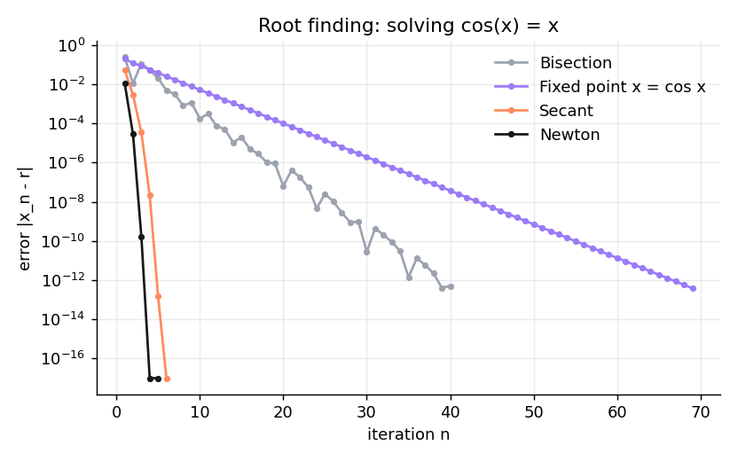
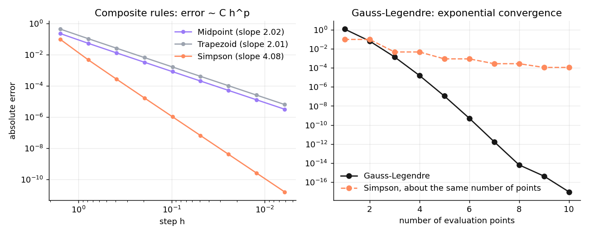
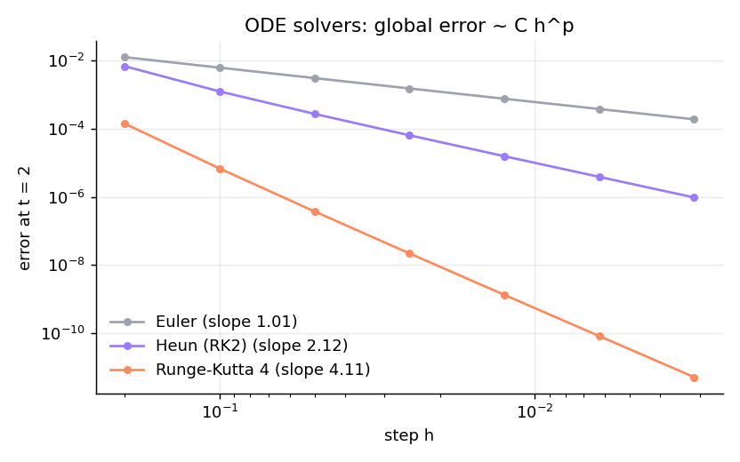
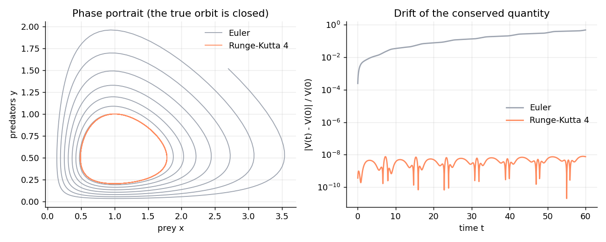
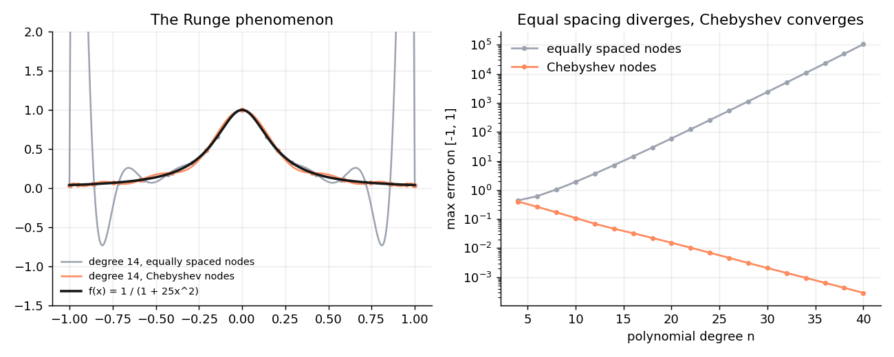
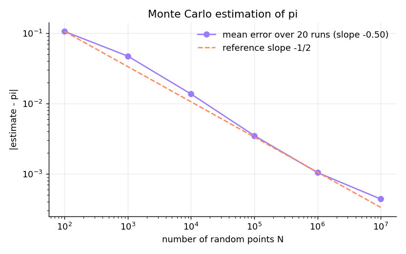

# numlab: a numerical analysis lab


*Version française : [README.md](README.md)*

I implemented the classic methods of numerical analysis in Python, then **checked experimentally that their convergence speeds match the theory**. Every number below is measured by the code in this repository, and automated tests fail if a convergence order drifts from its theoretical value.

| Area | Methods | What is verified |
|---|---|---|
| Nonlinear equations | bisection, fixed point, Newton, secant | orders 1, 1, 2 and $\varphi \approx 1.618$ |
| Numerical integration | midpoint, trapezoid, Simpson, Gauss-Legendre | orders 2, 2, 4 and exponential convergence |
| Differential equations | Euler, Heun (RK2), Runge-Kutta 4 | orders 1, 2, 4 and conservation of an invariant |
| Interpolation | barycentric Lagrange, equispaced vs Chebyshev nodes | the Runge phenomenon |
| Probability | Monte Carlo | error in $1/\sqrt{N}$ (central limit theorem) |

## Measuring a convergence order

If a method with step $h$ has error $e(h) \approx C\,h^p$, then $\log e = \log C + p \log h$, so the order $p$ is the **slope** of the least-squares line through $(\log h, \log e)$. For an iterative method with $e_{n+1} \approx C\,e_n^{\,q}$, the order is estimated by $q \approx \log(e_{n+1}/e_n) / \log(e_n/e_{n-1})$. Both are in [`numlab/convergence.py`](numlab/convergence.py).

## 1. Solving $\cos x = x$



| Method | Iterations (to $10^{-12}$) | Measured | Theory |
|---|---|---|---|
| Bisection | 40 | order 1, rate 0.502 | order 1, rate 1/2 |
| Fixed point $x = \cos x$ | 69 | order 1, rate 0.674 | order 1, rate $\sin r = 0.674$ |
| Secant | 6 | 1.60 | 1.618 |
| Newton | 5 | 2.00 | 2 |

## 2. Numerical integration of $\int_0^\pi \sin x\,dx = 2$



| Rule | Measured order | Theory |
|---|---|---|
| Midpoint | 2.02 | 2 |
| Trapezoid | 2.01 | 2 |
| Simpson | 4.08 | 4 |

Gauss-Legendre reaches an error of $1.1 \times 10^{-7}$ with only 5 points and machine precision with 10, because it is exact for polynomials of degree $\le 2n-1$ and $\sin$ is analytic.

## 3. Differential equations

For $y' = -2ty$, $y(0) = 1$ (exact solution $e^{-t^2}$), error at $t = 2$:



| Method | Measured order | Theory |
|---|---|---|
| Explicit Euler | 1.01 | 1 |
| Heun (RK2) | 2.12 | 2 |
| Runge-Kutta 4 | 4.11 | 4 |

The Lotka-Volterra predator-prey system $x' = \alpha x - \beta xy$, $y' = \delta xy - \gamma y$ conserves $V(x,y) = \delta x - \gamma \ln x + \beta y - \alpha \ln y$, so exact orbits are closed. With the same step $h = 0.05$ on $[0, 60]$, Euler spirals outwards (relative drift of $V$: $4.8 \times 10^{-1}$) while RK4 keeps the orbit closed (drift $7.9 \times 10^{-9}$):



## 4. Interpolation and the Runge phenomenon

Interpolating $f(x) = 1/(1+25x^2)$ on $[-1,1]$: with equispaced nodes the maximum error **grows** with the degree (1.9 at degree 10, $1.1 \times 10^5$ at degree 40), while Chebyshev nodes $x_k = \cos\frac{(2k+1)\pi}{2(n+1)}$ make it decrease geometrically ($2.9 \times 10^{-4}$ at degree 40).



## 5. Monte Carlo

Estimating $\pi$ from $N$ random points in the unit square: measured slope **−0.50** over 20 runs, as predicted by the central limit theorem. For $\int_0^\pi \sin x\,dx$ with $N = 100{,}000$: $2.0019$, 95% confidence interval $[1.9959, 2.0079]$, which contains the exact value 2.



## Usage

```bash
pip install -r requirements.txt
python experiments/run_all.py   # regenerates figures/ and results.md
pytest                          # runs the 26 tests
```

## Author

**Yassine Abderrezak Dache**, BSc in Computer Science (USTHB). GitHub: [@yassinedache](https://github.com/yassinedache). MIT licence.
